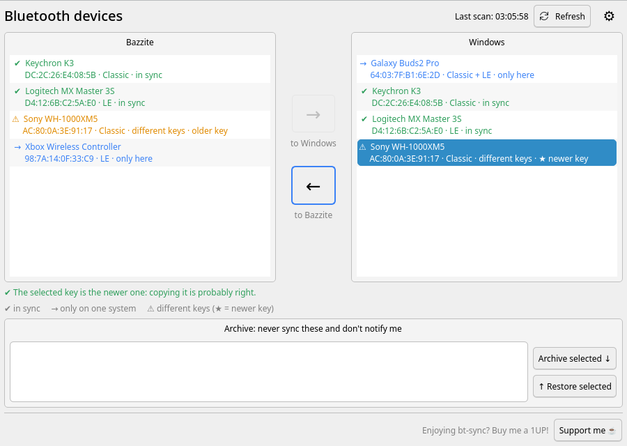
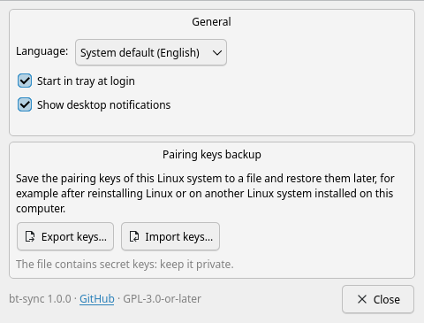

# bt-sync

**Keep your Bluetooth devices paired on both Linux and Windows in a dual-boot setup.**



When you pair a Bluetooth device, the device and the computer agree on a secret
pairing key. Linux and Windows share the same Bluetooth adapter but keep their
own copy of that key, so pairing on one system breaks the pairing on the other.
You end up re-pairing your headphones, mouse or controller every time you
switch OS.

bt-sync reads the pairing keys of both systems (BlueZ on Linux and the
`SYSTEM` registry hive on Windows), shows the differences and copies the keys
in the direction you choose. After that, the device works on both systems
without pairing it again.

- Tray app that tells you when something is out of sync
- Bluetooth Classic (BR/EDR) and Bluetooth Low Energy (LE) devices
- Copies keys in both directions: Windows → Linux and Linux → Windows
- When the keys differ, it tells you **which one is newer** and suggests the
  right direction
- **Key backup**: export the Linux pairing keys to a file and import them after
  reinstalling Linux, or into another Linux system on the same computer
- Translated into English, Italian, German, Spanish, French, Brazilian
  Portuguese, Russian, Simplified Chinese and Japanese. It follows the system
  language, and you can change it in the settings (⚙)
- A background scan mounts Windows **read-only**; the Windows partition is
  only mounted read-write when you ask to copy keys *to* Windows
- Backs up the Windows registry before every write
- No hardcoded partitions or devices: the Windows partition and the Bluetooth
  adapters are detected automatically

## Supported systems

| Distribution | Package |
|---|---|
| Arch Linux, CachyOS, EndeavourOS, Manjaro | AUR (coming soon), or [manual installation](#manual-installation) |
| Debian 12+, Ubuntu 22.04+, Linux Mint 21+, Pop!_OS, Zorin OS | `.deb` from the [releases page](https://github.com/Eraser-025/bt-sync/releases) |
| Fedora 43+ | `.rpm` from the [releases page](https://github.com/Eraser-025/bt-sync/releases) |
| Bazzite, Fedora Silverblue / Kinoite (atomic) | `.rpm` installed with `rpm-ostree` |

Windows 10 and 11 are supported. The Windows partition must be NTFS and **not
encrypted with BitLocker**.

bt-sync needs Python 3.8+, PyQt6 (PyQt5 is used automatically where PyQt6 is
not available, e.g. Ubuntu 22.04 / Mint 21), hivex, BlueZ, polkit and systemd.
The packages install all of them.

## Installation

### Arch Linux and derivatives

The AUR package is on its way (`paru -S bt-sync`). Until then use the
[manual installation](#manual-installation).

### Debian, Ubuntu, Linux Mint, Pop!_OS, Zorin OS

Download `bt-sync_<version>-1_all.deb` from the
[latest release](https://github.com/Eraser-025/bt-sync/releases/latest), then:

```sh
sudo apt install ./bt-sync_*_all.deb
```

The background scan is enabled automatically.

### Fedora

Download `bt-sync-<version>-1.fc<NN>.noarch.rpm` from the
[latest release](https://github.com/Eraser-025/bt-sync/releases/latest), then:

```sh
sudo dnf install ./bt-sync-*.noarch.rpm
```

### Bazzite, Silverblue, Kinoite and other Fedora Atomic desktops

These systems have a read-only `/usr`, so bt-sync is layered with
`rpm-ostree`, which also installs its dependencies (`python3-pyqt6`,
`python3-hivex`). Download the `.rpm` from the
[latest release](https://github.com/Eraser-025/bt-sync/releases/latest), then:

```sh
rpm-ostree install ./bt-sync-*.noarch.rpm
systemctl reboot
```

### Enabling the background scan

On Arch, Fedora and Bazzite, packages do not enable services by themselves.
The first time you open bt-sync it offers an **Enable now** button. You can
also run:

```sh
sudo bt-sync setup
# same as: sudo systemctl enable --now bt-sync-scan.timer bt-sync-scan.path
```

### Manual installation

You need `make` and `gettext`, plus the runtime dependencies listed above.

```sh
git clone https://github.com/Eraser-025/bt-sync.git
cd bt-sync
sudo make PREFIX=/usr/local install
sudo bt-sync setup
```

Uninstall with `sudo make PREFIX=/usr/local uninstall`.

## Usage

### Recommended workflow

The pairing key that counts is the one from the system where you paired the
device **last**: copy *from* that system. bt-sync shows it with a ★ when it
can tell from the timestamps.

1. Pair the device on Linux.
2. Boot Windows and pair the device there too (this invalidates the Linux key).
3. Shut down Windows (see [Fast Startup](#fast-startup-and-hibernation)) and
   boot Linux.
4. Open **Bluetooth Sync**, select the device in the *Windows* list and press
   **←** to copy the Windows key to Linux.

Copying in the other direction (**→**, Linux to Windows) works as well. It is
handy when you pair a new device on Linux and want it on Windows without
pairing it again there.

### The window

| Mark | Meaning |
|------|---------|
| ✔ | In sync on both systems |
| → | Paired on one system only (or only partly synced) |
| ⚠ | Paired on both systems with **different** keys: the arrow overwrites the other side |
| ★ | The newer of two different keys: this is probably the one to copy |

Select devices in one list and press the arrow that starts from that list. The
suggested arrow is highlighted, and bt-sync warns you if you are about to
overwrite a newer key with an older one.

Devices you never want to sync can be moved to the **Archive**. bt-sync then
ignores them and stops notifying you about them.

Copying keys requires your administrator password (polkit). When keys are
copied to Linux, the Bluetooth service restarts, so connected devices drop for
a moment.

### Settings (⚙)



- **Language**: system default or any of the available translations.
- **Start in tray at login** and **Show desktop notifications**.
- **Pairing keys backup**: *Export keys…* saves the pairing keys of this Linux
  system to a file (readable only by you). *Import keys…* restores them, for
  example after reinstalling Linux or on another Linux system installed on the
  same computer. Keys only work with the same Bluetooth adapter, and the
  import shows what will change before doing it.

> [!CAUTION]
> A key backup contains the secret pairing keys of your devices. Keep it
> private.

### Command line

```sh
sudo bt-sync status                       # show the differences
sudo bt-sync apply                        # interactive sync in the terminal
sudo bt-sync scan                         # rescan now (what the timer does)
sudo bt-sync export-keys > keys.json      # back up the Linux pairing keys
sudo bt-sync import-keys --dry-run < keys.json
sudo bt-sync import-keys [--overwrite] < keys.json
```

## Configuration

`/etc/bt-sync.conf`:

```ini
[bt-sync]
# Try this if an LE device connects after syncing but loses the pairing
# after a while: some Windows versions store the IRK byte-reversed.
reverse_irk = false
# Number of Windows registry backups kept in /var/lib/bt-sync/backups
keep_backups = 5
```

## Warnings — please read

> [!WARNING]
> bt-sync writes to the Windows registry when you copy keys to Windows. A
> backup of the `SYSTEM` hive is saved in `/var/lib/bt-sync/backups` before
> every write, but **use it at your own risk** and keep your own backups of
> important data.

### Fast Startup and hibernation

If Windows was hibernated or *Fast Startup* is enabled, the Windows partition
is left in a "dirty" state. Linux can then only mount it read-only, and
writing to it could corrupt it. bt-sync detects this and refuses to write to
Windows. To fix it, open an administrator prompt in Windows, run

```bat
powercfg /h off
```

and always use **Shut down** (not *Restart* into Linux) before booting Linux.
Reading Windows keys still works when the partition is read-only.

### BitLocker

bt-sync cannot read a BitLocker-encrypted Windows partition (Windows 11 often
enables *Device encryption* by default). It tells you when it finds one.

### Same adapter

Keys are matched by the MAC address of the Bluetooth adapter. If your adapter
reports a different address on Linux and Windows, bt-sync has nothing to
match.

### Permissions and what runs as root

- `bt-sync-scan.service` runs as **root** every 30 minutes (and when you press
  *Refresh*). It mounts the Windows partition read-only under `/run/bt-sync`,
  reads the keys and unmounts it, unless you had already mounted it yourself.
- It writes `/var/lib/bt-sync/state.json`, which is **world-readable** and
  contains device names, MAC addresses and the dates the keys changed, but
  **never the keys**.
- `/var/lib/bt-sync/refresh.trigger` is **world-writable** so that the GUI can
  request a rescan: any local user can trigger a scan, nothing else.
- The GUI runs as your user. Copying, exporting and importing keys runs
  `bt-sync` as root through `pkexec` (polkit action
  `io.github.eraser025.btsync.apply`, administrator password required).
  When copying, the root helper only accepts *which* device to copy and in
  *which* direction; it always re-reads the keys itself.
- Registry backups in `/var/lib/bt-sync/backups` are readable by root only.
  They contain secrets from your Windows installation, so do not share them.

## Troubleshooting

- **"The background scan is not enabled"**: press *Enable now*, or run
  `sudo bt-sync setup`. Check the scan with `journalctl -u bt-sync-scan.service`.
- **"Windows is mounted read-only"**: see [Fast Startup](#fast-startup-and-hibernation).
- **An LE device pairs but disconnects after a while**: set
  `reverse_irk = true` in `/etc/bt-sync.conf`, then sync the device again.
- **Restore a registry backup** (from Linux, with Windows shut down): mount the
  Windows partition read-write and copy
  `/var/lib/bt-sync/backups/SYSTEM.<date>` over
  `Windows/System32/config/SYSTEM`.

## Translations

The translations live in [`po/`](po/) as standard gettext files. To fix a
translation or add a language:

1. Run `make update-po` to refresh the template `po/bt-sync.pot`.
2. Edit `po/<language>.po`. For a new language, copy `po/bt-sync.pot` to
   `po/<language>.po` and add the language to `LANGUAGES` in
   [`btsync/i18n.py`](btsync/i18n.py).
3. Run `make` to check it compiles, then open a pull request.

## Development

```sh
make                                    # compile the translations
python3 -m unittest discover -s tests   # unit tests (no root or hardware needed)
./bt-sync-gui                           # run the GUI from the source tree
BT_SYNC_STATE=docs/demo-state.json ./bt-sync-gui   # GUI with fake devices
```

Packages: `packaging/deb/build-deb.sh` and `packaging/rpm/build-rpm.sh` (also
run by GitHub Actions for every release).

## License

Copyright (C) 2026 Eraser-025

bt-sync is free software, released under the
[GNU General Public License v3.0 or later](LICENSE) (`GPL-3.0-or-later`).

## Support

If bt-sync saved you some re-pairing, you can buy me a 1UP ☕

[](https://ko-fi.com/eraser117)

Ko-fi accepts PayPal and cards: <https://ko-fi.com/eraser117>
